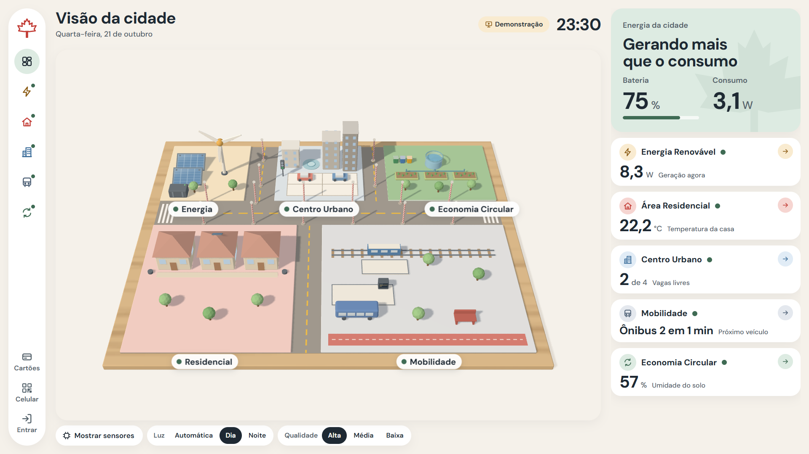

# Smart Canada 2050: painel da cidade (Módulo 6)

Painel web da maquete **Smart Canada 2050** (Mostra Internacional, 1º INFO B): um gêmeo digital em 3D da maquete que recebe os dados dos ESP32 pela Wi-Fi do projeto e manda comandos de volta. Funciona sem internet e roda num notebook com Windows, sem instalar nada.



*A captura acima foi feita no modo demonstração (dados simulados).*

> **Estado do projeto:** o painel, o servidor e o 3D foram conferidos no computador de desenvolvimento. **Os sketches dos ESP32 NÃO foram compilados** e **os pinos dos sketches são palpites**; os nomes dos campos são proposta que o grupo ainda precisa confirmar (`docs/API.md`). Nada foi testado com ESP32 de verdade nem no notebook do professor.

## Baixar

Baixe o `smart-canada-dashboard.zip` na página de Releases do repositório: **https://github.com/SMariotto/dashboard-mostra-internacional/releases/latest** (uns 35 MB; leva a interface já compilada e o Node portátil). Windows 64 bits.

## Rodar no notebook (passos curtos)

1. Extraia o zip numa pasta (por exemplo `C:\SmartCanada`). Não precisa de `npm install`, de Node instalado nem de internet.
2. Copie `config\local.exemplo.json` para `config\local.json` e troque os códigos e a chave (veja "Códigos de acesso" abaixo). O zip não traz o `local.json` de propósito.
3. Dê dois cliques em `INICIAR.bat`. Uma janela preta abre, o servidor liga e o navegador abre o painel (ele tenta abrir em tela cheia; se não abrir assim, aperte F11). **Não feche a janela preta.**
4. **Firewall do Windows:** na primeira vez o Windows pergunta se deixa o Node usar a rede. Clique em **Permitir** (pode pedir a senha de administrador). Sem isso a tela do próprio notebook funciona, mas os ESP32 e os celulares não chegam.
5. Para ligar nos dados dos ESP32, escreva `"modo": "real"` no `config\local.json` (ou rode `INICIAR.bat --modo real`, ou troque em Admin, "Modo de dados"). Sem isso o painel liga em **demonstração** (dados simulados).
6. Para desligar, feche a janela preta.

A pílula perto do relógio mostra de onde vêm os dados: **Demonstração** (simulados), **Ao vivo** (pelo menos um ESP32 mandando leitura de sensor), **Teste** (os ESP32 mandam só valores de teste) ou **Sem leituras** (nenhum ESP32 chegou ainda).

### Códigos de acesso (`config\local.json`)

```json
{
  "codigos": { "controle": "um-codigo-seu", "administracao": "outro-codigo-seu" },
  "chaveModulos": "uma-chave-sua"
}
```

- `codigos`: o que cada pessoa digita em **Entrar** (menu lateral) para ter o papel de Controle ou de Administração. Sem esse arquivo o painel funciona só para visualização.
- `chaveModulos`: tem que ser **igual** à `CHAVE_MODULOS` dos 5 sketches. Leitura com chave errada é recusada.
- Esse arquivo **não vai para o git nem para o zip.** Não mande para ninguém.
- Outras opções aceitas: `"modo": "real"`, `"modoInicial": "cartoes"` (ou `"3d"`; padrão `"auto"`) e a rede do QR (`"rede": {"nome": "...", "senha": "..."}`, mais fácil de digitar em Admin).

## Conectar os ESP32

1. **Rede de 2,4 GHz.** O ESP32 não conecta em rede de 5 GHz. Use um roteador ou o hotspot do celular em 2,4 GHz, e ligue o notebook na mesma rede. Use uma Wi-Fi só para o projeto, não a da escola nem a de casa.
2. **Constantes no topo de cada sketch** (seção CONFIGURAÇÃO, na pasta `esp32/`): `WIFI_REDE` e `WIFI_SENHA` (a rede do dia), `CHAVE_MODULOS` (igual à do servidor), `IP_RESERVA` e `PORTA_RESERVA` (veja o passo 4). Depois, uma constante por sensor (`S10_LIGADO` etc.: `true` só onde o sensor está ligado de verdade) e uma só `MODO_TESTE` (padrão `false`). **Nunca suba a senha real da Wi-Fi para o GitHub.**
3. **Descoberta por UDP.** O servidor anuncia o próprio endereço na rede (porta UDP 5051, a cada 2 s). O ESP32 escuta por 10 s ao ligar e acha o servidor sozinho, mesmo se o IP do notebook mudar.
4. **IP fixo de reserva.** Se o anúncio não chegar em 10 s, o ESP32 usa o `IP_RESERVA` do sketch. Para esse IP não mudar, reserve um IP para o notebook no roteador (reserva de DHCP) ou fixe o IP no Windows, e escreva o mesmo número no `IP_RESERVA` dos 5 sketches.
5. **Onde ver o IP:** na janela preta ("Na rede: http://...") e, no painel, em **Entrar** (código de Administração), depois **Admin**, bloco "Endereço do painel", em letras grandes.
6. **Conferir:** em Admin, "Modo de dados" em **Real (ESP32)**, e **Testar comandos**: as 5 áreas devem aparecer respondendo. Em até 6 s cada área fica verde depois que o ESP32 manda a primeira leitura.

Passo a passo de gravação, bibliotecas e o que fazer quando algo falha: `esp32/README.md`. Campos, faixas e rotas: `docs/API.md`. Desenho da rede: `docs/REDE.md`.

### Valor de teste

Sensor desligado no sketch **não manda o campo** e o cartão mostra "--". Com `MODO_TESTE = true`, o sketch manda um valor de teste e `"teste": true`: o painel mostra o selo **Valor de teste** e a pílula do topo diz **Teste**, nunca "Ao vivo". Antes da Mostra, deixe `MODO_TESTE = false` nos 5 sketches.

## Problemas comuns

| Sintoma | Causa provável | O que fazer |
|---|---|---|
| Uma área está **Sem sinal** (ou todas) | O ESP32 está desligado, longe do roteador, em outra rede ou com chave errada. Sem leitura há mais de 6 s vira "Sem sinal". | Veja o Monitor Serial do ESP32 (115200): `Chave errada` (confira `CHAVE_MODULOS`) ou `Sem resposta do servidor` (veja a linha do firewall). Confira se o modo é **Real (ESP32)** em Admin. |
| **Testar comandos** mostra uma área sem resposta (ping sem resposta) | O ESP32 não está lendo os comandos: está sem sinal, é de outro módulo ou tem o sketch com nome de comando diferente do contrato. | Primeiro resolva o "Sem sinal". Depois confira no Monitor Serial se aparece `Comando recebido: ping`. Área que não responde ao teste também não responde aos comandos de verdade. |
| O painel abre no notebook, mas **ESP32 e celulares não chegam** (firewall) | O Firewall do Windows bloqueou o Node na primeira vez. | Feche e abra o `INICIAR.bat`, e clique em **Permitir** quando o Windows perguntar. Se já clicou em "Cancelar", libere o `node.exe` (pasta `tools\node`) em Segurança do Windows, Firewall, "Permitir um aplicativo". Teste com um celular na mesma Wi-Fi. |
| ESP32 imprime pontinhos e **"NÃO conectou"** (5 GHz) | A rede é de 5 GHz, o nome ou a senha estão errados, ou o roteador está longe. | Use rede de **2,4 GHz**. Se o roteador junta 2,4 e 5 GHz com o mesmo nome e não conecta, crie uma rede só de 2,4 GHz. Confira maiúsculas e espaços no nome e na senha. |
| Teste com `curl` responde **"JSON inválido."** | O arquivo foi salvo com BOM (o `Set-Content -Encoding utf8` do PowerShell 5.1 põe um BOM no começo). | Salve com `-Encoding ascii` (exemplo em `docs/API.md`). Os sketches não têm esse problema. |
| `INICIAR.bat` diz **"O Node.js não foi encontrado"** | O `tools\node\node.exe` sumiu da pasta (ou você está rodando o código do GitHub, que não traz o Node) e não há Node instalado. | Use o zip da Release (traz o Node portátil). Se o arquivo sumiu, a própria mensagem explica como baixar o Node "Windows Binary (.zip)" e copiar para `tools\node`. |
| A pílula diz **Demonstração** na Mostra | O servidor está no modo demonstração (os valores são simulados). | Em Admin, "Modo de dados", escolha **Real (ESP32)**, ou ponha `"modo": "real"` no `config\local.json`. |
| A pílula diz **Teste** | Os ESP32 estão mandando valores de teste (`MODO_TESTE = true`). | Ponha `MODO_TESTE = false`, ligue as constantes dos sensores que existem e grave de novo. |
| O mapa 3D fica lento ou entram os **cartões** sozinhos | O notebook não tem placa de vídeo boa. | É o plano B funcionando. Fixe a tela com `"modoInicial": "cartoes"` no `config\local.json`, ou use o botão "Tentar o 3D de novo". |
| O painel mostra **"Sem conexão"** | O servidor parou (a janela preta foi fechada). | Abra o `INICIAR.bat` de novo. |

## Estrutura de pastas

- `servidor/`: o servidor (Node puro, sem dependências) e `servidor/publico/` (a interface já compilada, que vai no git).
- `web/`: o código da interface (cartões em `web/ui/`, mapa 3D em `web/cena/`, estilos em `web/estilo/`).
- `compartilhado/`: `contrato.js` (campos e comandos) e `maquete.js` (geometria da planta). Fonte única do servidor, da interface e dos testes.
- `esp32/`: os 5 sketches e a biblioteca de rede `SmartCanadaRede.h`.
- `config/`: `padrao.json` (valores padrão) e `local.exemplo.json` (modelo; o `local.json` fica só no computador).
- `ferramentas/`: capturas de tela, conferências, `esp-falso.js` e o gerador do pacote zip.
- `docs/`: guias, `API.md`, `REDE.md`, `DECISOES.md` (todas as decisões) e `shots/` (capturas).
- `testes/`: os testes automáticos.

## Comandos de desenvolvimento (precisa do Node 24 e de `npm install` uma vez)

- `npm run dev`: abre em http://localhost:5173 com o servidor junto.
- `npm run build`: gera `servidor/publico/` (faça commit depois).
- `npm test`: roda os testes e a conferência dos sketches contra o contrato.
- `npm run pacote`: gera `entrega\smart-canada-dashboard.zip` (precisa do `npm run build` antes).
- `node ferramentas/esp-falso.js`: finge ser os 5 ESP32 (servidor em modo real). Com `--teste` manda valores marcados como de teste.
- `node ferramentas/conferir-esp32.js`: confere os sketches e o `docs/API.md` contra o contrato e o servidor (não compila nada).
- `npm run shots`: capturas de tela em `docs/shots/` (precisa do `npm run build` antes).
- `npm run cena`: confere a cena 3D contra a planta e mede os quadros por segundo.
- `npm run contraste`: confere o contraste das cores.

## Documentos

- `docs/GUIA-DO-OPERADOR.md`: uma página para imprimir, com o passo a passo do dia e a lista de conferência da véspera.
- `docs/DIA-DA-MOSTRA.md`: roteiro e ensaio das 6 demonstrações.
- `docs/REDE.md`: esquema da rede (Mermaid).
- `docs/PUBLICAR-NO-GITHUB.md`: passos manuais para publicar este repositório e a Release.
- `esp32/README.md`: guia da turma para gravar os ESP32.

## Histórico das leituras

O servidor guarda as leituras em `dados\historico-AAAA-MM-DD.jsonl` (uma linha por módulo a cada 10 s) e nunca apaga esses arquivos. A administração exporta tudo em CSV.
