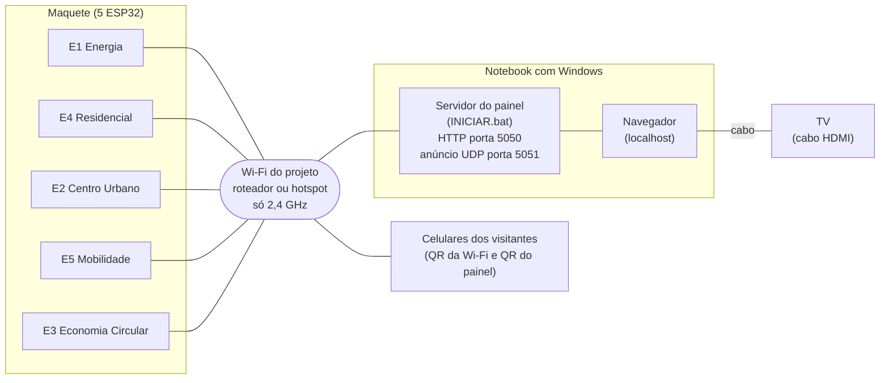
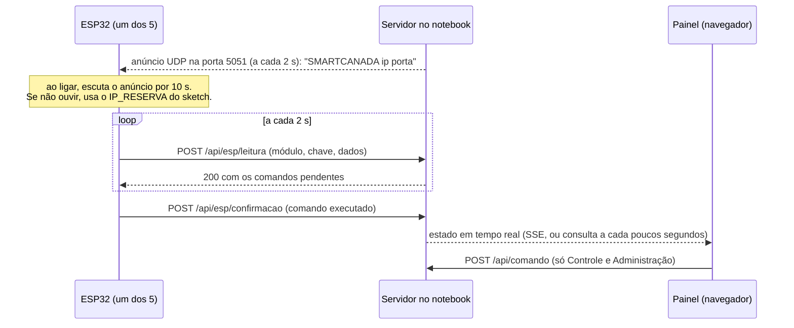

# Rede da Smart Canada 2050

Este documento mostra **como os aparelhos se falam na rede**. Ele **não** mostra ligação elétrica dos sensores (veja a última seção).

## Esquema da rede

Legenda:

- Os **5 ESP32** conectam na Wi-Fi do projeto. **Só 2,4 GHz**: o ESP32 não conecta em rede de 5 GHz.
- O **notebook** roda o servidor (`INICIAR.bat`). Ele precisa estar **na mesma Wi-Fi** dos ESP32 e dos celulares.
- A **TV** mostra o painel pelo navegador do próprio notebook, ligada por cabo (HDMI). Não passa pela Wi-Fi.
- Os **celulares** entram na Wi-Fi pelo primeiro QR e abrem o painel (`http://<IP do notebook>:5050/?modo=celular`) pelo segundo QR. Os dois QR ficam na tela do botão **Celular**.
- Não precisa de internet em nenhum ponto.

## O que cada aparelho manda

Detalhes dos campos, faixas e erros: `API.md`.

## Endereços e portas

| O quê | Valor | Observação |
|---|---|---|
| Painel e API | `http://<IP do notebook>:5050` | Se a porta 5050 estiver ocupada, o servidor usa a próxima livre (até 5060) e mostra qual na janela preta. |
| Anúncio do servidor | UDP `5051` | Broadcast na rede local, a cada 2 s. |
| Wi-Fi | 2,4 GHz | O mesmo nome e senha para os ESP32, o notebook e os celulares. |
| IP do notebook | aparece na janela preta ("Na rede") e em Admin, "Endereço do painel" | Para o IP não mudar, reserve-o no roteador e escreva o mesmo número no `IP_RESERVA` dos sketches. |

## Se algo não conversa

- **Firewall do Windows:** o Node precisa de permissão na primeira vez ("Permitir"). Sem ela, a tela do notebook funciona e os ESP32 e celulares não chegam.
- **Isolamento de clientes ("AP isolation")** em alguns roteadores impede que aparelhos da mesma Wi-Fi se falem. Desligue essa opção.
- **Duas redes com o mesmo nome (2,4 e 5 GHz):** o notebook pode estar na de 5 GHz e o ESP32 na de 2,4 GHz. Em geral conversam, mas se não, ligue o notebook na de 2,4 GHz.

## Ligação dos sensores: a preencher depois que o grupo confirmar os pinos

**Esta seção está vazia de propósito.** Os pinos escritos nos sketches (`// TODO: confirmar pino`) são **palpites**, e os sensores ainda não foram ligados e conferidos com os ESP32 de verdade. Por isso este documento **não traz** esquema elétrico nem tabela de pinos: um desenho aqui parecia fato e não é.

Quando o grupo confirmar, preencher aqui, por módulo (E1 a E5): qual sensor (S1 a S18, P1, P2) liga em qual pino, a alimentação de cada um, e quem confirmou e quando. Depois, trocar os pinos nos sketches e tirar os `TODO`.
